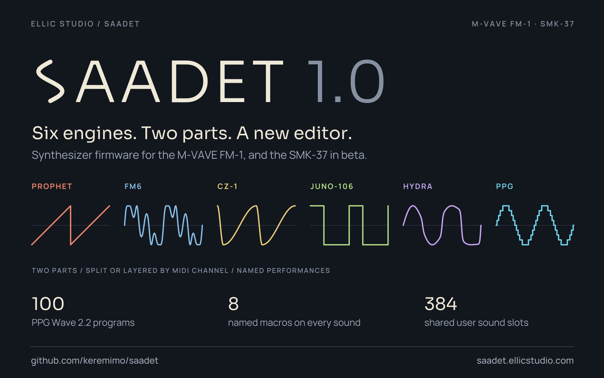

# Saadet

A six-engine, two-part synthesizer for the **M-VAVE FM-1**, with Bluetooth MIDI and Saadet Studio, its editor in the
browser. It also builds for the **M-VAVE SMK-37**, in beta. Saadet began as a fork of Melodee.

[Install Saadet](https://keremimo.github.io/saadet/install/) ·
[Saadet Studio](https://saadet.ellicstudio.com) ·
[Quick start](QUICKSTART.md) ·
[Releases](https://github.com/keremimo/saadet/releases)

> **Back up first.** Back up sounds and settings before switching firmware, and read the
> [release notes](RELEASE_NOTES.md) for what has and has not been measured on a unit.

## Play and shape sounds

Choose **Prophet, FM6, CZ-1, JUNO-106, HYDRA or PPG** on each of two parts. Edit sounds on the
panel or in [Saadet Studio](https://saadet.ellicstudio.com), with factory libraries and native SysEx import/export.

- **Perform:** arpeggiator, HOLD, chords, strum, scales and microtonal tuning.
- **Keep your sounds:** favourites, 384 shared user slots and automatic last-sound recall.
- **Connect:** USB MIDI, TRS MIDI input and Bluetooth MIDI; stereo USB playback
  and synth-master capture at 44.1 kHz, with 16/24-bit USB formats.

  
  

Open either graphic for a closer look. The common audio path renders at native
24-bit precision, independently of the selected USB format. Saadet is a dedicated
synth of up to two parts, played by MIDI channel, split or layered, with named
performances; sequencing, multitrack recording and shared insert effects are
outside its scope.

## Quick-start cheat sheet

The main controls beside six native firmware UI captures, rendered by the host
harness. Open the image for the full-resolution PNG, or use the
[written quick start](QUICKSTART.md) and [complete panel guide](docs/UI.md).

  

## Storage and compatibility

**Installing and saving Saadet over Melodee can replace Melodee project A data.**
Keep a backup before switching firmware families. Melodee project and backup files
cannot be restored as Saadet backups. The editor's Settings page provides complete
Saadet backups of sounds, favourites and settings.

Flash layouts, backup formats and legacy sound compatibility are covered in the
[technical overview](docs/TECHNICAL_OVERVIEW.md#storage-and-compatibility).

## Documentation

- [Panel guide](docs/UI.md): editing, performance controls, Bluetooth and SysEx.
- [Build, test and recovery](BUILDING.md): firmware targets, installer and optional m-bootloader.
- [Release notes](RELEASE_NOTES.md) and [changelog](CHANGELOG.md): what is in each release.
- [Brand](assets/brand/README.md): the wordmark, colours, type and voice.
- [Technical overview](docs/TECHNICAL_OVERVIEW.md): architecture, compatibility and project history.

## Validation and provenance

Automated checks cover engines, MIDI, storage, UI, native 24-bit transport and
firmware packaging. Physical audio quality and sustained timing still need
hardware validation; see the [validation record](docs/VALIDATION.md) and
[BLE migration record](docs/BLE_MIGRATION.md).

New Saadet/Melodee work is by **Kerem Kilic (Ellic Studio)**. Retained Felucca work
is by **Leo Kuroshita (@kurogedelic), Hügelton Instruments**, with its notices kept.
FM6 uses the MSFA renderer; factory sound data retains its vendor attribution.
See [LICENSING.md](LICENSING.md), [LICENSE](LICENSE) and [LICENSES](LICENSES/)
for the applicable file-by-file terms and third-party notices.

## Support
[Buy me a coffee](https://ko-fi.com/keremimo)

You can also try Saadet in the browser, no flashing needed, in the free community [FM-1 Emulator](https://fm1-emulator.atst.tools/).
